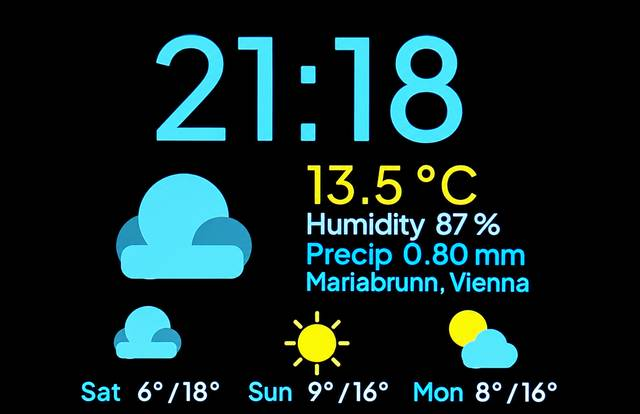
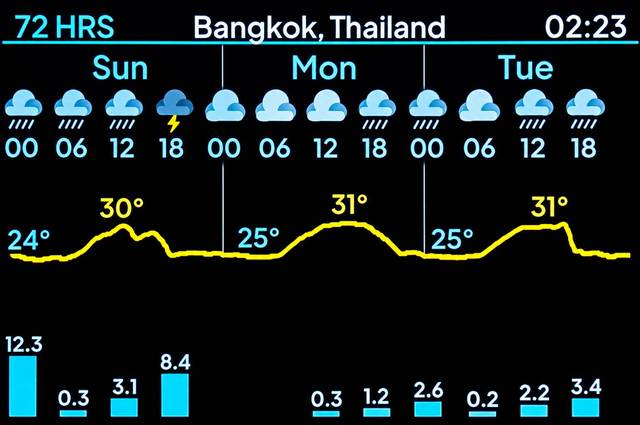
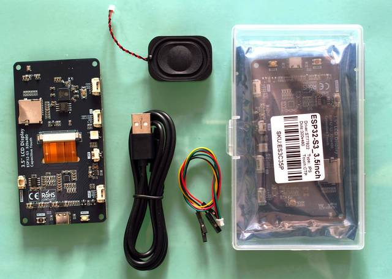

# Holo9 Weather - Internet Weather Station for the ESP32-S3 with 3.5" Display


---

## 🌤️ What is Holo9 Weather?

Holo9 Weather is a simple, internet-connected weather station powered by an ESP32-S3 microcontroller with an attached 3.5" QSPI  capacitive touch display. It fetches weather forecasts from Open-Meteo's global weather API and presents them in a stylish, easy-to-read format across four different screens.

Whether you're a weather enthusiast, a maker looking for a practical ESP32 project, or just want a stylish way to check the forecast, Holo9 Weather will give you 4 screens with different information. Rotate through the 4 screens with a simple tap anywhere on the touch screen or the lower right corner to get to the settings menu:

- **Current conditions** with temperature, humidity, wind, and precipitation

  

- **Sense Clock mode** - a simple clock with today's weather

    

- **72-hour hourly forecast** showing temperature trends and rain probability over the coming 3 days

    

- **10-day daily forecast** with high/low temperatures and weather icons

    

- **Settings** for location, weather model, units, and WiFi networks rotating through hard coded settings for each

    

The interface is designed to be simple, intuitive, and visually appealing, with smooth vector graphics using the full 320*480 resolution and a dark theme that's easy on the eyes.

---

## 🖥️ Hardware

You won`t need much for this project. It does not involve any soldering or even connecting external sensors. The ESP32S3 with display is fully (well kind of, it helps to have a USB connection for power and Wifi) self sufficient. The display is already connected to the ESP32 and once set up all interaction happens through the capacitive touch screen.  

### Here is what you need:

 

**ESP32-S3 Microcontroller**

- Dual-core Xtensa LX7 processor running at 240 MHz
- 8 MB PSRAM and 8 MB flash memory
- WiFi 4 (802.11n) and Bluetooth 5.0
- Native USB-C connectivity
- Low power consumption with multiple sleep modes

**Display: 3.5" ST77922 QSPI TFT**

- 320×480 resolution (3:2 aspect ratio)
- Bright, vibrant colors with 16-bit RGB565 color depth
- Capacitive touch interface for navigation
- QSPI interface for fast data transfer
- IPS panel with wide viewing angles

**Additional Features**

- Built-in RGB LED indicator
- MicroSD card slot (unused in current firmware)
- Onboard speaker (unused in current firmware)
- Battery charging circuit (unused in current firmware)

---

## 💻 Software & Code

### Architecture Overview

Holo9 Weather is built on the Arduino framework with several key components:

#### Core Components:

- **Open-Meteo API Integration**: Fetches weather data from [open-meteo.com](https://open-meteo.com), a free weather API that provides global forecast data
- **Vector Graphics Engine**: Uses OpenFontRender for crisp, scalable text rendering
- **Custom Display Drivers**: ST77922 driver for the QSPI display and ST77922_Touch for capacitive touch
- **Preferences System**: Persistent storage of settings using the ESP32's Preferences library

#### Weather Data Structure:

The code fetches and stores:

- **Current conditions**: Temperature, humidity, wind speed/direction, pressure, sunrise/sunset times
- **Hourly forecast**: 120 hours of temperature, precipitation, and weather codes
- **Daily forecast**: 10 days of high/low temperatures, precipitation, and weather codes

#### User Interface:

Five rotating screens provide different views:

1. **Current Weather**: Main dashboard with current conditions
2. **Sense Clock**: Large clock with weather summary
3. **72-Hour Forecast**: Hourly temperature and precipitation trends
4. **10-Day Forecast**: Daily high/low temperatures with weather icons
5. **Settings**: Configuration for location, weather model, units, and WiFi

#### Key Features:

- **Automatic refresh**: Data updates every 10 minutes
- **Timezone support**: Automatic timezone adjustment based on location
- **Unit conversion**: Toggle between metric (°C, km/h, mm) and imperial (°F, mph, in)
- **Multiple weather models**: Choose from best_match, icon_seamless, geosphere_seamless, ecmwf_ifs04, or gfs_seamless
- **Touch navigation**: Simple tap to cycle through screens

---

## 📦 Installation & Setup

### Required Tools & Libraries

#### Hardware Setup:

1. **ESP32-S3 board** with 8MB PSRAM and 8MB flash
2. **3.5" ST77922 QSPI display** (the one from [lcdwiki.com](https://www.lcdwiki.com/3.5inch_ESP32-S3_Display))
3. **USB-C cable** for programming and power
4. **WiFi network** (2.4GHz recommended)

#### Software Requirements:

- **Arduino IDE** (2.3.2 or later recommended)
- **ESP32 Arduino Core** (version 3.0.0 or later)
- **Required Libraries** (install via Library Manager or GitHub):
  - `WiFi` (built-in)
  - `HTTPClient` (built-in)
  - `ArduinoJson` (by Benoit Blanchon, version 6.x)
  - `TFT_eSPI` (by Bodmer, version 2.x)
  - `Preferences` (built-in)
  - `OpenFontRender` (by takkaO)
  - `ST77922` (custom library for your display)
  - `ST77922_Touch` (custom library for touch interface)
  - `PlusJakarta` (embedded TTF font)

#### Arduino IDE Configuration:

1. **Install ESP32 Board Support**:

   - Open Arduino IDE

   - Go to **File > Preferences**

   - Add this URL to "Additional Boards Manager URLs":

     ```
     https://raw.githubusercontent.com/espressif/arduino-esp32/gh-pages/package_esp32_index.json
     ```

   - Go to **Tools > Board > Boards Manager**

   - Search for "esp32" and install "esp32 by Espressif Systems"

2. **Select the Correct Board**:

   - **Tools > Board > ESP32 Arduino > ESP32S3 Dev Module**
   - **Tools > Partition Scheme > 8M with spiffs (1.5MB APP, 7.5MB SPIFFS)**
   - **Tools > PSRAM > OPI PSRAM**
   - **Tools > USB Mode > Hardware CDC and JTAG**
   - **Tools > Upload Mode > UART**
   - **Tools > Port** (select your COM port)

3. **Install Dependencies**:

   - Install all required libraries via **Sketch > Include Library > Manage Libraries**
   - For custom libraries (ST77922, ST77922_Touch):
     - Place them in your Arduino libraries folder
     - Or use **Sketch > Add .ZIP Library**

### Flashing the Firmware

1. **Download the Code**:

   ```bash
   git clone https://github.com/yourusername/Holo9_Weather.git
   cd Holo9_Weather
   ```

2. **Configure WiFi**:

   - Open `Holo9_Weather.ino` in Arduino IDE

   - Edit the `WIFI_PRESETS` array in the code:

     ```cpp
     const WifiCredential WIFI_PRESETS[] = {
         {"YOUR_SSID", "YOUR_PASSWORD"},
         {"YOUR_SSID_2", "YOUR_PASSWORD_2"},
         {"YOUR_SSID_3", "YOUR_PASSWORD_3"}
     };
     ```

   - Change the SSID and password to match your WiFi network(s)

3. **Configure Location**:

   - Edit the `LOCATIONS` array to set your preferred location:

     ```cpp
     const LocationPreset LOCATIONS[] = {
         {"Your City, Country", latitude, longitude, "timezone", "POSIX timezone string"},
         // ...
     };
     ```

   - Example:

     ```cpp
     {"Mariabrunn, Vienna", 48.20695487974676, 16.22939762373813, "Europe%2FVienna", "CET-1CEST,M3.5.0,M10.5.0/3"}
     ```

4. **Upload the Code**:

   - Connect your ESP32-S3 via USB
   - Select the correct COM port in Arduino IDE
   - Click **Upload** (→)
   - Wait for compilation and upload to complete

5. **First Run**:

   - The display will show a splash screen while connecting to WiFi
   - After successful connection, weather data will be fetched and displayed
   - If WiFi connection fails, the device will retry automatically

---

## 🎛️ Usage & Navigation

### Screen Navigation

Simply **tap the settings icon** in the bottom-right corner to cycle through the five different screens:

1. **Current Weather** (📍 Main dashboard)

   - Current temperature, humidity, wind, and pressure
   - Today's sunrise and sunset times
   - Hourly forecast for the next 12 hours
   - Weather icon representing current conditions

2. **Sense Clock** (⏰ Beautiful clock mode)

   - Large, easy-to-read clock
   - Current temperature and humidity
   - Today's precipitation forecast
   - Location name
   - Weather icon

3. **72-Hour Forecast** (📈 Temperature trends)

   - Hourly temperature graph for the next 72 hours
   - Precipitation bars showing rain probability
   - Weather icons for each 6-hour period
   - Day/night indicators

4. **10-Day Forecast** (📅 Extended outlook)

   - Daily high/low temperatures
   - Weather icons for each day
   - Precipitation amounts
   - Smooth temperature trend line

5. **Settings** (⚙️ Configuration)

   - Change location, weather model, units, and WiFi
   - Save settings and reconnect to WiFi
   - All settings are saved to persistent storage

### Settings Explained:

- **Location**: Choose from predefined cities or add your own coordinates
- **Model**: Select weather model (best_match typically gives good results)
- **WiFi**: Choose from up to 3 saved WiFi networks
- **Units**: Toggle between metric and imperial units

---

## 🛠️ Tips & Recommendations

### Power Options:

- **USB Power**: Use a standard 5V/1A USB power adapter
- **Battery**: The board has a battery connector (not implemented in current firmware)
- **Low Power**: For battery operation, you'd need to implement deep sleep modes

### Display Customization:

- The code uses a dark theme with accent colors (blue, yellow, grey)
- Fonts are embedded as TTF files for crisp rendering
- Weather icons are vector-based and scale smoothly

### Weather Model Selection:

- **best_match**: Automatically selects the best available model
- **icon_seamless**: Good for Europe
- **geosphere_seamless**: High-resolution global model
- **ecmwf_ifs04**: European Centre for Medium-Range Weather Forecasts
- **gfs_seamless**: Global Forecast System (US)

### Troubleshooting:

- **WiFi Connection Issues**: Check your SSID and password, ensure 2.4GHz network
- **Display Not Working**: Verify QSPI wiring, check display initialization
- **Touch Not Responding**: Ensure touch driver is properly initialized
- **Weather Data Not Updating**: Check internet connection, verify API endpoint

### Enhancement Ideas:

- Add local sensor support (temperature, humidity, pressure)
- Implement MQTT for IoT integration
- Add weather alerts/notifications
- Create custom weather icons
- Add moon phase display
- Implement a screensaver mode

---

## 📜 License

Holo9 Weather is open source software released under the **MIT License**.

The weather icons and fonts are used under their respective licenses:

- Weather icons: Custom vector art
- Plus Jakarta font: SIL Open Font License
- OpenFontRender library: FTL License

---

## 🤝 Contributing

Contributions are welcome! Feel free to:

- Report bugs and suggest features by opening an issue
- Submit pull requests for improvements
- Share your build photos and modifications
- Help improve documentation

---

## 📸 Gallery


*Beautiful clock mode showing current weather*


*Detailed hourly forecast with temperature trends*


*Extended outlook with daily highs and lows*


*Easy configuration interface*

---

## 📚 Resources

- [ESP32-S3 Datasheet](https://www.espressif.com/sites/default/files/documentation/esp32-s3_datasheet_en.pdf)
- [Open-Meteo Weather API](https://open-meteo.com)
- [ST77922 Display Datasheet](https://www.lcdwiki.com/3.5inch_ESP32-S3_Display)
- [Arduino-ESP32 Documentation](https://docs.espressif.com/projects/arduino-esp32/en/latest/)
- [TFT_eSPI Library](https://github.com/Bodmer/TFT_eSPI)

---

**Built with ❤️ by makers, for makers**

Enjoy your Holo9 Weather station! May it bring you beautiful forecasts and happy making. 🌦️✨
