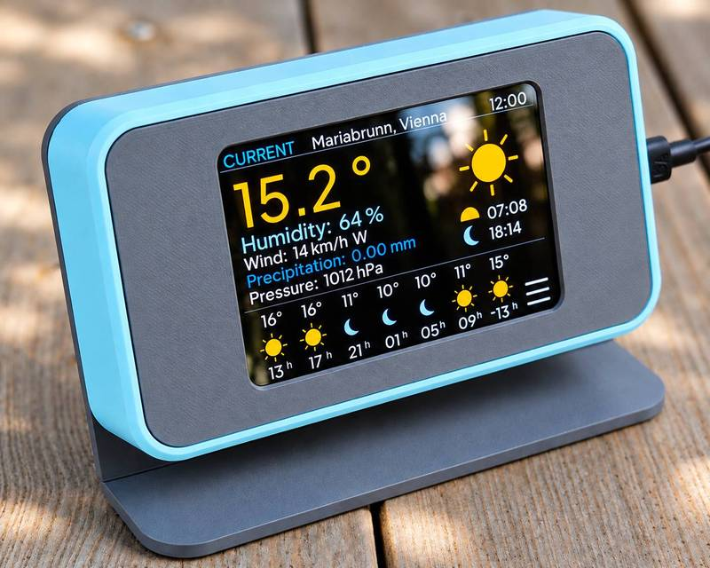
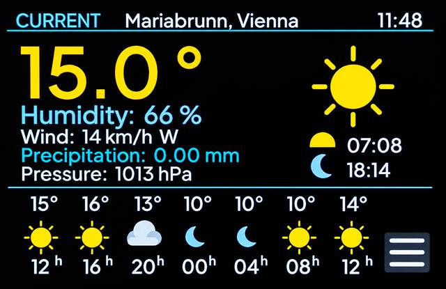
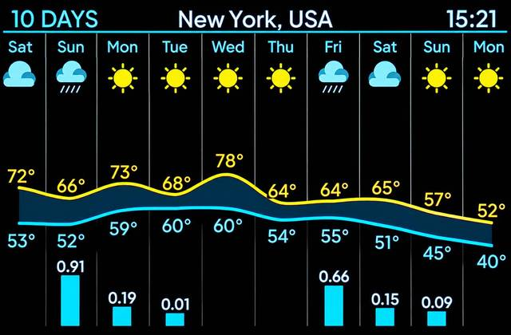
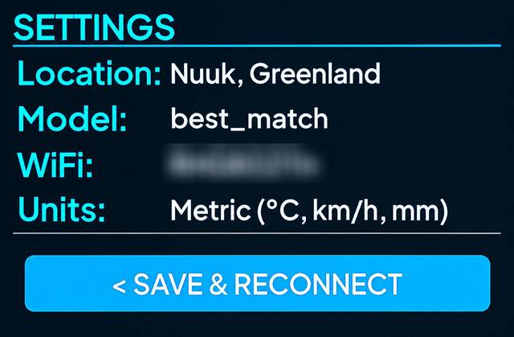
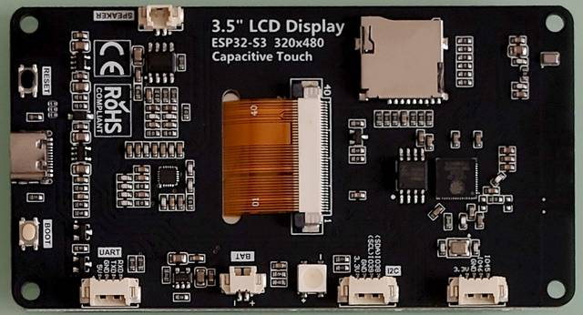
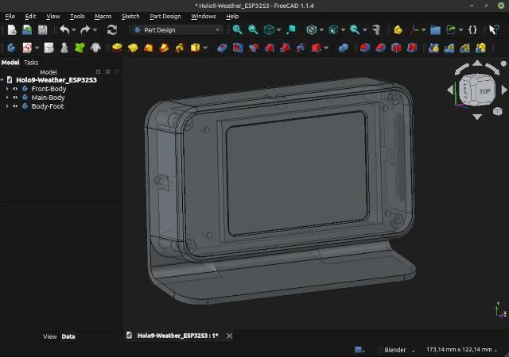

# Holo9 Weather - Internet Weather Station for the ESP32-S3 with 3.5" Display



---
## 🌤️ In Brief

Holo9 Weather is an internet-connected weather station powered by an  [ESP32-S3 microcontroller with an attached 3.5" QSPI  capacitive touch display](https://link.amazon/B0hpUn6v9) in an (optional) stylish printed enclosure that sits on your desk or wall.

It features
- 4 + 1 Screens (current weather, weather clock, 72h forecast, 10-day forecast + settings)
- Free access to Open-Meteo's global weather API (no registration) with multiple prediction models to chose from
- Everything operated from touch screen (no soldering or external buttons)
- Settings screen for location, prediction model, WiFi, and metric/imperial unit selection
- Additional settings in a separate presets file (e.g. temp ranges, nighttime dimming etc.)
- OTA updates or flash code via Arduino IDE
- STL files included for 3D-printing the enclosure

## 🌤️ What is Holo9 Weather?

Holo9 Weather is a simple, internet-connected weather station powered by an ESP32-S3 microcontroller with an attached 3.5" QSPI  capacitive touch display. It fetches weather forecasts from Open-Meteo's global weather API and presents them in a stylish, easy-to-read format across four different screens. Rotate through the 4 screens with a simple tap anywhere on the touch screen or the lower right corner to get to the settings menu:

- **Current conditions** with temperature, humidity, wind, and precipitation

  

- **Sense Clock mode** - a simple clock with basic weather information

    

- **72-hour hourly forecast** showing temperature trends and precipitation over the coming 3 days

    

- **10-day daily forecast** with high/low temperatures and weather icons

    

- **Settings** for location, weather model, units, and WiFi networks rotating through hard coded settings for each

    

I tried to keep the interface simple, intuitive, and visually appealing, with smooth vector graphics using as much of the full 320*480 resolution as possible and a dark theme that's easy on the eyes.

---

## 🖥️ Hardware

You won`t need much for this project. It does not involve any soldering or even connecting external sensors. The ESP32S3 with display is fully (well kind of, it helps to have a USB connection for power and Wifi) self sufficient. The display is already connected to the ESP32 and once set up all interaction happens through the capacitive touch screen.  

### Here is what you need:

Essentially this is a one item shopping list:

- ##### [Your ESP32-S3 with 3.5" 320 × 480, QSPI capacitive touch screen (using an ST77922 controller)](https://link.amazon/B0hpUn6v9)

  This is a roughly USD/EUR 25 development board sold under a number of different brand names (Elecrow, Hosyond...). Why this one? This is essentially a CYD on steroids for just a few bucks more, still ultra compact but much better and slightly bigger screen, QSPI display with capacitive touch and a modern ST77922 controller, way more RAM, more power... 

  Make sure you get the 3.5" (not 2.8") version. It is a black (unlike CYDs) development board. Look out for the "3.5" LCD Display ESP32-S3 320x480 Capacitive Touch" label on its back. I found it on the US Amazon website as "Hosyond ESP32-S3 Touchscreen Module, 3.5" 240x320 IPS LCD EPS32 Display", which is obviously a typo (as it is 320x480) but should nevertheless be the one you are looking for (remember, take a look at the back).

  

  

  

  It comes with a built in SD-card reader, microphone, external speaker (which we all won`t be using) and an USB-A to USB-C cable (which we WILL be using), built in Wifi and BT and battery charging circuit (nice if you want to add a battery - I tried, it runs on a fully charged 3000mAh battery pack for around 24h)

  


Here the full specs, documentation, pinout etc:  https://www.lcdwiki.com/3.5inch_ESP32-S3_Display

**ESP32-S3 Microcontroller**

- Dual-core Xtensa LX7 processor running at 240 MHz
- 384 KB ROM + 512KB SRAM + 16 KB RTC SRAM + 8M OPI PSRAM + 16M QSPI Flash
- WiFi 4 (802.11n). 2.4GHz and Bluetooth 5.0
- Native USB-C connectivity
- Low power consumption with multiple sleep modes

**Display: 3.5" ST77922 QSPI TFT**

- 320×480 resolution (3:2 aspect ratio)
- Bright, vibrant colors with 16-bit RGB565 color depth
- Capacitive touch interface for navigation
- QSPI interface for fast data transfer
- IPS panel with wide viewing angles


---

## 💻 Software & Code

### Adressing that ST77922 Screen:

If you have been playing around with the ESP32 (e.g. with the CYD) things like TFT_eSPI.h (Thx to Bodmer for this wonderful lib) will instantly look familiar. However, since this board is using a modern QSPI interface and an ST77922 screen, which are not supported, you can`t directly write to the screen. Instead you write to an off-screen frame buffer (TFT_eSprite canvas) and then push the sprite buffer to the physical QSPI display using the provided ST77922 driver. Sounds slightly complicated (and took me some time to find out) but ultimately a very simple concept, which allows you to use the full power of the TFT_eSPI library.

#### A Few More Components:

- **Open-Meteo API Integration**: Fetches weather data from [open-meteo.com](https://open-meteo.com) in Switzerland, a free weather API that provides global forecast data and multiple models
- **Fonts**: Uses OpenFontRender (Copyright (c) takkaO FTL License) for scalable text rendering
- **Custom Display Drivers**: ST77922 driver for the QSPI display and ST77922_Touch for capacitive touch. Very basic drivers essentially just used to push the data from the frame-buffer to the screen
- **Preferences System**: Persistent storage of settings using the ESP32's Preferences library
- **OTA Updates**: Using ElegantOTA (Copyright Ayush Sharma 2026 AGPL-3.0 License)
- **Automatic refresh**: Data updates every 10 minutes (can be adjusted in the Presets)
- **Timezone support**: Automatic timezone adjustment based on location
- **Unit conversion**: Toggle between metric (°C, km/h, mm) and imperial (°F, mph, in)
- **Multiple weather models**: Choose from best_match, icon_seamless, geosphere_seamless, ecmwf_ifs04, or gfs_seamless

#### Weather Model Selection (in Settings):

- **best_match**: Automatically selects the best available model. This works really well for most instances
- **icon_seamless**: DWD (German Meteorological Service) model, global, particularly good for Europe
- **geosphere_seamless**: High-resolution global model focus on Central Europe
- **ecmwf_ifs04**: European Centre for Medium-Range Weather Forecasts model
- **gfs_seamless**: Global Forecast System by the US NWS

#### User Interface:

Four rotating screens provide different views. Tap on the screen anywhere outside the lower right corner to get to the next screen.

1. **Current Weather**: Main dashboard with current conditions
2. **Sense Clock**: Large clock with weather summary
3. **72-Hour Forecast**: Hourly temperature and precipitation trends
4. **10-Day Forecast**: Daily high/low temperatures with weather icons

Tap the lower right corner to reach

1. **Settings**: Configuration for location, weather model, units, and WiFi (these are all hard coded in Holo9Presets.h) 

---

## 📦 Installation & Setup

### Required Tools & Libraries

It should essentially be very simple. Connect your ESP32 board to your computer via the cable that came with the board. 

#### Software Requirements:

- **Arduino IDE** (2.3.2 or later recommended)
- **ESP32 Arduino Core** (version 3.0.0 or later)
  
#### Arduino IDE Configuration:

1. **Install ESP32 Board Support**:

   - Open Arduino IDE
   - Go to **File > Preferences**
   - Add this URL to "Additional Boards Manager URLs": https://espressif.github.io/arduino-esp32/package_esp32_index.json
   - Go to **Tools > Board > Boards Manager**
   - Search for "esp32" and install "esp32 by Espressif Systems"
   - **Tools > Board > ESP32 Arduino > ESP32S3 Dev Module**
   - **Tools > Partition Scheme > 8M with spiffs (3MB APP, 1.5MB SPIFFS)**
   - **Tools > PSRAM > OPI PSRAM**
   - **Tools > USB Mode > Hardware CDC and JTAG**
   - **Tools > Upload Mode > UART/Hardware CDC**
   - **Tools > Port** (select your COM port)

3. **Install Dependencies**:

   - Install all required libraries via **Sketch > Include Library > Manage Libraries**
   - For custom libraries (ST77922, ST77922_Touch):
     - Place them in your Arduino libraries folder
     - Or use **Sketch > Add .ZIP Library**

    - `WiFi` (built-in)
    - `HTTPClient` (built-in)
    - `ArduinoJson` (by Benoit Blanchon, version 6.x)
    - `TFT_eSPI` (by Bodmer, version 2.x)
    - `Preferences` (built-in)
    - `OpenFontRender` (by takkaO)
    - `ElegantOTA` (for OTA Update)
    - `ST77922` (custom library for your display, .zip included, use Sketch > Add .ZIP Library to install)
    - `ST77922_Touch` (custom library for touch interface, .zip included, use Sketch > Add .ZIP Library to install)
    - `PlusJakarta` (embedded TTF font - place PlusJakarta.h in the same directory as the code)

### Flashing the Firmware

1. **Download the Code**:
2. **Configure WiFi**:
   - Open `.ino` in Arduino IDE
   - Edit the `WIFI_PRESETS` array in the Holo9Presets.h code. Most of the time you will just need one, so this is in case you keep moving your ESP:
     ```cpp
     const WifiCredential WIFI_PRESETS[] = {
         {"YOUR_SSID", "YOUR_PASSWORD"},
         {"YOUR_SSID_2", "YOUR_PASSWORD_2"},
         {"YOUR_SSID_3", "YOUR_PASSWORD_3"}
     };
     ```

   - Change the SSID and password to match your WiFi network(s)

3. **Configure Location**:

   - Edit the `LOCATIONS` array to set your preferred location:

     ```cpp
     const LocationPreset LOCATIONS[] = {
         {"Your City, Country", latitude, longitude, "timezone", "POSIX timezone string"},
         // ...
     };
     ```

   - The easiest way to find your exact location is to look it up in Google Maps, then right click and get the location data. To get the full data with timezone and posix string copy one of the locations and ask Google to give you the exact same info for your location.

     ```cpp
     {"Mariabrunn, Vienna", 48.207, 16.229, "Europe%2FVienna", "CET-1CEST,M3.5.0,M10.5.0/3"}
     ```

4. **Upload the Code**:

   - Connect your ESP32-S3 via USB
   - Select the correct COM port in Arduino IDE
   - Click **Upload** (→)
   - Wait for compilation and upload to complete

5. **First Run**:

   - The display will show a splash screen while connecting to WiFi
   - After successful connection, weather data will be fetched and displayed
   - If WiFi connection fails, the device will retry automatically and/or try one of the other WiFi networks
   - If you get stuck somewhere, check all your data and reflash
   - Tap the lower right corner on any page, choose your location, preferred forecast model, and imperial/metric and click exit. These values will be stored even if you power down.

6. **Settings** :

   - **Location**: Choose from predefined cities or add your own coordinates
   - **Model**: Select weather model (best_match typically gives good results, see above for details)
   - **WiFi**: Choose from up to 3 saved WiFi networks hard-coded in Presets
   - **Units**: Toggle between metric and imperial units
   - Settings will be saved on exit

---

### 🛠️ Printing and Assembling the Enclosure:

The .stl files are in the 3D_stl directory. All files and instructions on the my Printables page at https://www.printables.com/model/1888752-esp32-s3-35-development-board-case-holo9-weather-s



Hand-crafted on FreeCAD (like all my other designs - thx to the makers) this should be an easy and fast print. With one minor exception (the opening for the USB port at the side of the main body) you will not need any supports. 

Filament. I used dark gray PLA for the front and foot and light blue for the main body. Looks really nice but feel free to use any color and material you like.

Printing. I use 3 bottom layers, 3 walls, and 30% infill but essentially whatever your standard settings are will likely work. Turn the front so that the outside is at the bottom and the foot so that it stands upright. Supports only on the side opening of the main body.

Assembly. 1.) Mount the ESP32 board to the front cover (there are 4 little notches that should perfectly fit the screw holes of the board - either add a small drop of glue to each of these or use a soldering iron to flatten the notches). 2.) Mount the main body to the front with 4 small screws (I use 3 x 15mm wood screws but any short M3 screw will do or you can just glue it) 3.) Mount the foot to the back of the main body with 3 of the same screws. Plug the USB cable in and you should be ready to go.

---

### 📜 Licenses and Credits 📚

Thanks to all the folks who contributed to this project (without knowing):

- Weather data: [Open-Meteo](https://open-meteo.com/) (free for non-commercial use, [attribution required](https://open-meteo.com/en/license))
- [TFT_eSPI](https://github.com/Bodmer/TFT_eSPI) by Bodmer (FreeBSD)
- [OpenFontRender](https://github.com/takkaO/OpenFontRender) by takkaO (FTL)
- [Plus Jakarta Sans](https://github.com/tokotype/PlusJakartaSans) by Tokotype (SIL OFL)
- [ElegantOTA](https://github.com/ayushsharma82/ElegantOTA) by Ayush Sharma (AGPL 3.0)
- Holo9 Weather © 2026 Harald Noedl, released under the **MIT License**

---

**Hope you like it and if you like it please like ❤️ it!**


